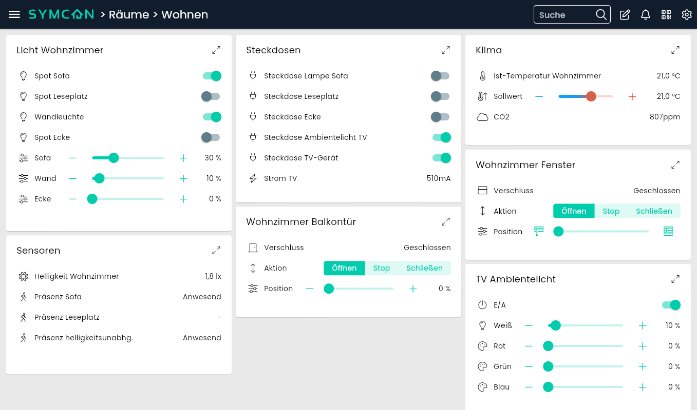
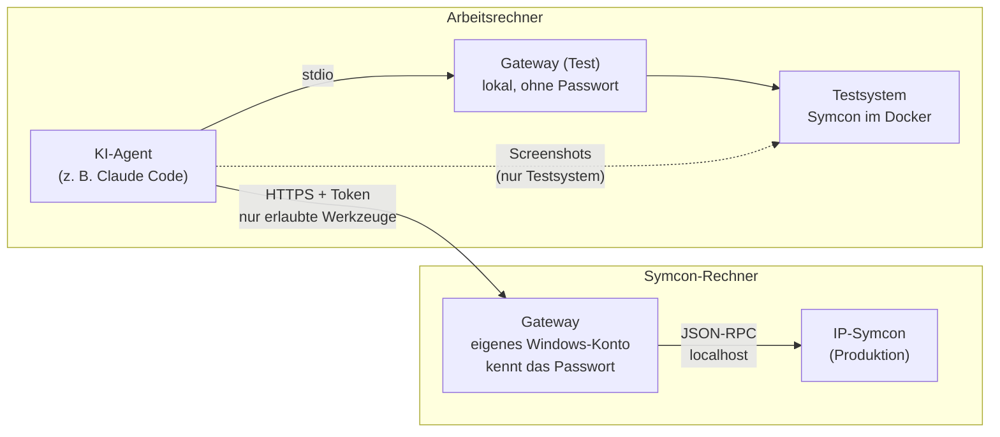
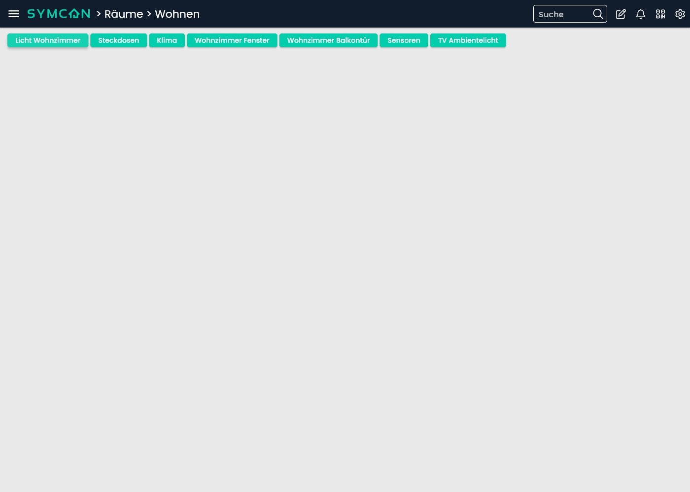
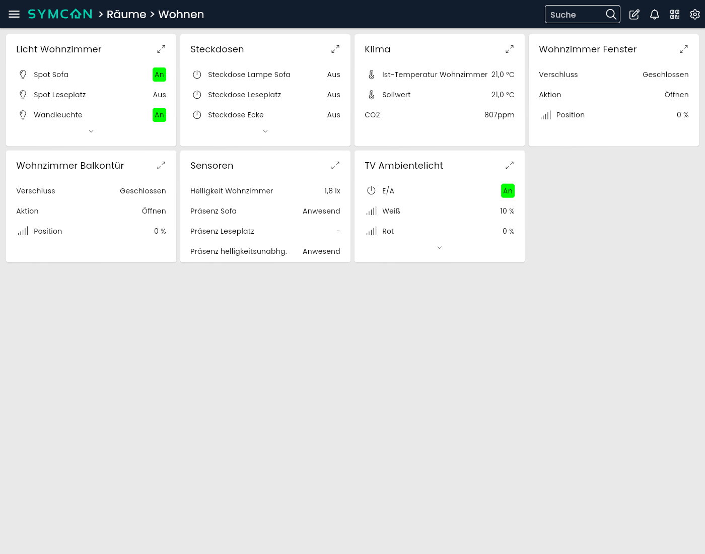
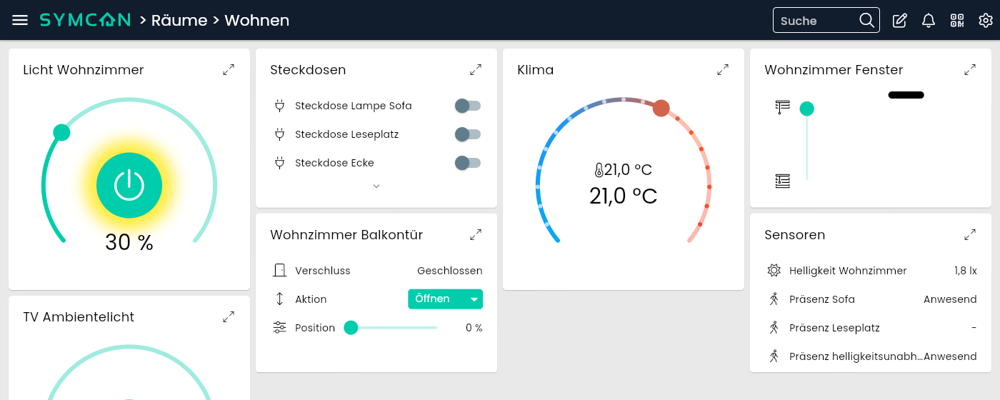
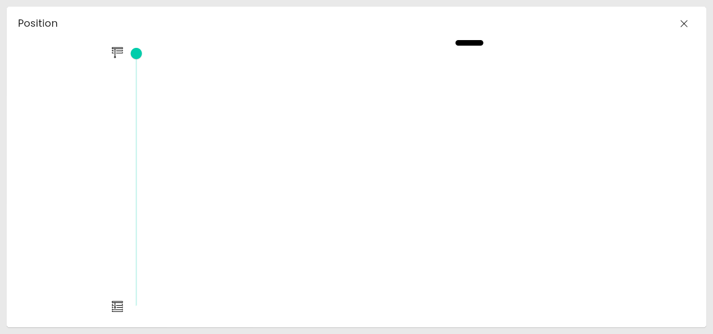

# Sanfte Migration: vom WebFront zur Kachelvisu mit einem KI-Agenten

Diese Anleitung beschreibt, wie du die Struktur einer bestehenden **WebFront-Visualisierung** von IP-Symcon mit Hilfe
eines KI-Agenten (z. B. Claude Code) in die **Kachelvisualisierung** überführst, ohne dass die gewohnte Ansicht verloren
geht. Sie beruht auf einer echten Migration (IP-Symcon 9.0, rund 300 Links auf 7 Seiten) und erklärt jeden Schritt,
auch die Fehlversuche, damit du sie nicht wiederholen musst.

> **Kurz gesagt:** Die neue Visu entsteht in einer eigenen, leeren Kategorie und besteht nur aus Links auf deine
> vorhandenen Variablen. Das alte WebFront bleibt unverändert und läuft parallel weiter. Der KI-Agent liest die alte
> Struktur, baut sie nach und darf dabei nur in dieser einen Kategorie schreiben. Ein kleines Programm, das
> **Gateway**, setzt diese Grenze technisch durch und verhindert, dass der Agent deine Zugangsdaten zu sehen bekommt.

## Inhalt

1. [Für wen ist das?](#1-für-wen-ist-das)
2. [Was „sanfte Migration“ hier bedeutet](#2-was-sanfte-migration-hier-bedeutet)
3. [Warum ein Gateway? (Sicherheit)](#3-warum-ein-gateway-sicherheit)
4. [Überblick: Wer macht was?](#4-überblick-wer-macht-was)
5. [Schritt 1 – Vorbereitung in Symcon](#schritt-1--vorbereitung-in-symcon)
6. [Schritt 2 – Testsystem mit Docker](#schritt-2--testsystem-mit-docker)
7. [Schritt 3 – Gateway auf dem Symcon-Rechner](#schritt-3--gateway-auf-dem-symcon-rechner)
8. [Schritt 4 – KI-Agent verbinden](#schritt-4--ki-agent-verbinden)
9. [Schritt 5 – Bestandsaufnahme (nur lesen)](#schritt-5--bestandsaufnahme-nur-lesen)
10. [Schritt 6 – Die richtige Struktur finden (im Testsystem)](#schritt-6--die-richtige-struktur-finden-im-testsystem)
11. [Schritt 7 – Darstellung, Design und Icons](#schritt-7--darstellung-design-und-icons)
12. [Schritt 8 – Bauplan (Spec) erzeugen](#schritt-8--bauplan-spec-erzeugen)
13. [Schritt 9 – Pilot: erst Test, dann Produktion](#schritt-9--pilot-erst-test-dann-produktion)
14. [Schritt 10 – Den Rest übernehmen](#schritt-10--den-rest-übernehmen)
15. [Schritt 11 – Kachelgrößen für PC, Tablet und Handy](#schritt-11--kachelgrößen-für-pc-tablet-und-handy)
16. [Schritt 12 – Abschluss und Rückweg](#schritt-12--abschluss-und-rückweg)
17. [Was du von Hand machen musst](#was-du-von-hand-machen-musst)
18. [Stolpersteine und Erkenntnisse](#stolpersteine-und-erkenntnisse)
19. [So sprichst du mit dem Agenten](#so-sprichst-du-mit-dem-agenten)
20. [Anhang: Werkzeuge und Dateiformate](#anhang-werkzeuge-und-dateiformate)

---

## 1. Für wen ist das?

Für dich, wenn

- du eine gewachsene **WebFront-Visu** hast (Seiten, Räume, darin Gruppen mit Links auf Variablen),
- du auf die **Kachelvisu** umsteigen möchtest, aber nicht alles von Hand neu klicken willst,
- die neue Visu **zunächst so aussehen und gegliedert sein soll wie die alte**, damit sich im Haushalt niemand umgewöhnen muss,
- du Zugang zu einem **KI-Agenten** hast, der Programme ausführen und Werkzeuge über MCP nutzen kann
  (Beispiel in dieser Anleitung: [Claude Code](https://claude.com/claude-code)),
- du **kein Programmierer** sein musst, aber bereit bist, ein paar Befehle zu kopieren und Ergebnisse zu prüfen.

Begriffe, die immer wieder vorkommen:

| Begriff | Bedeutung |
|---|---|
| **WebFront** | die alte Visualisierung von Symcon (Konfigurator mit Reitern, Kategorien, Splitpanes) |
| **Kachelvisu** | die neue Visualisierung (Instanz „Tile Visualization“), läuft im Browser und in der Symcon-App |
| **Objektbaum** | der Baum aus Kategorien, Instanzen, Variablen, Links in der Verwaltungskonsole |
| **Link** | ein Verweis auf ein anderes Objekt; die Kachelvisu zeigt das Ziel an, bedient wird das Original |
| **Dummy-Instanz** | eine leere Instanz („Dummy Module“), die nur als Behälter dient; im WebFront oft für Gewerk-Boxen benutzt |
| **KI-Agent** | ein Sprachmodell, das selbst Befehle ausführen und Werkzeuge aufrufen kann |
| **MCP** | „Model Context Protocol“, der Standard, über den ein Agent externe Werkzeuge benutzt |
| **Gateway** | das Programm aus diesem Repository: der einzige Weg des Agenten zu Symcon, mit festen Grenzen |
| **Spec** | eine JSON-Datei, die den Aufbau der neuen Visu beschreibt (Bauplan) |
| **Produktion** | deine echte Symcon-Installation, im Gegensatz zum **Testsystem** |

## 2. Was „sanfte Migration“ hier bedeutet

Die Migration folgt fünf Grundsätzen. Sie machen den Umstieg risikoarm und jederzeit umkehrbar:

1. **Parallel statt ersetzen.** Die neue Visu entsteht in einer eigenen Kategorie, hier „Kachelvisu-Neu“. Das WebFront
   wird nicht angefasst und bleibt benutzbar, bis du es nicht mehr brauchst.
2. **Nur Links, keine Kopien.** Die neue Struktur verweist auf deine vorhandenen Variablen. Schalten, Dimmen,
   Sollwerte ändern funktioniert dadurch sofort, und es gibt keine doppelten Daten.
3. **Erst die alte Struktur, dann verschönern.** Seiten, Räume, Gewerk-Boxen, Reihenfolge und Icons werden
   übernommen, wie sie sind. Neue Ideen (andere Gliederung, eigene Kacheln) kommen später, wenn alles läuft.
4. **Test vor Produktion.** Jede neue Idee wird zuerst in einem Testsystem (Symcon im Docker-Container) ausprobiert und
   per Screenshot geprüft. Auf die echte Anlage kommt nur, was dort funktioniert hat.
5. **Rückweg ist trivial.** Inhalt von „Kachelvisu-Neu“ löschen, fertig. Es gibt keinen Zustand, in dem die alte Visu
   kaputt ist.

So sieht das Ergebnis im Testsystem aus: ein Raum mit seinen Gewerk-Boxen wie im WebFront, jede Box eine Kachel mit
Liste und Bedienelementen.



## 3. Warum ein Gateway? (Sicherheit)

Das ist der wichtigste Abschnitt. Bitte nicht überspringen.

**Was der Agent liest, verlässt dein Haus.** Ein KI-Agent schickt alles, was er sieht, an den Anbieter des
Sprachmodells. Im Symcon-Objektbaum stecken aber oft Zugangsdaten: Passwörter und API-Schlüssel in der
Konfiguration von Modulen (Viessmann, Miele, Cloud-Dienste), in Skripten, manchmal in String-Variablen.

**Die Symcon-Schnittstelle kennt keine halben Rechte.** Symcon bietet eine JSON-RPC-Schnittstelle (Port 3777), über
die man jede PHP-Funktion aufrufen kann, auch `IPS_GetConfiguration` (liest Modulkonfigurationen mit Passwörtern) und
`IPS_RunScriptText` (führt beliebigen Code auf dem Server aus). Angemeldet wird mit der Lizenz-E-Mail und dem
Fernzugriffs-Passwort. Wer dieses Passwort hat, hat **volle Kontrolle** über Symcon und den Rechner dahinter.

Es gibt fertige MCP-Server für Symcon (z. B. [Schimmilab/ipsymcon-mcp-server](https://github.com/Schimmilab/ipsymcon-mcp-server),
von dem dieses Repository abgeleitet ist). Für eine Visu-Migration geben sie dem Agenten aber mehr, als er braucht:
Skripte lesen und ausführen, Werte setzen, beliebige Funktionen aufrufen. Ein Schalter „nur lesen“ hilft nicht, denn
schon das Lesen kann Zugangsdaten preisgeben. Regeln wie „lies bitte keine Passwörter“ sind nur Bitten an den Agenten
und keine Sperre.

**Darum dieses Gateway.** Es sitzt zwischen Agent und Symcon und lässt nur durch, was für die Visu nötig ist:

| Erlaubt | Gesperrt (technisch, nicht per Bitte) |
|---|---|
| Objektbaum, Namen, Positionen, Icons lesen | Modulkonfiguration lesen (`IPS_GetConfiguration`) |
| Variablen-Metadaten, Werte, formatierte Werte lesen | Skripte lesen, anlegen, ändern, ausführen |
| Links auflösen, Profile, WebFront-Konfiguration lesen | Werte setzen, Geräte schalten, Aktionen auslösen |
| Kategorien, Dummy-Gruppen, Links anlegen, umbenennen, sortieren, löschen – **nur unterhalb der Zielkategorie** | irgendetwas außerhalb der Zielkategorie verändern |
| Kachelgrößen der einen Kachelvisu-Instanz setzen (optional) | Eigenschaften von Instanzen ändern |

Zusätzlich:

- **Secret-Filter:** Alle Antworten werden durchsucht. Strings mit verdächtigen Namen (Passwort, Token, Key, Benutzer,
  Mail, Seriennummer …), token-artige Zeichenketten und Zugangsdaten in URLs werden als `***REDACTED***` maskiert.
- **Das Passwort liegt nur beim Gateway.** Das Gateway läuft auf dem Symcon-Rechner unter einem eigenen Windows-Konto.
  Nur dieses Konto darf die Konfigurationsdatei mit dem Passwort lesen. Der Agent auf deinem Arbeitsrechner kennt nur
  ein Zugangs-Token für das Gateway, nicht das Symcon-Passwort.
- **Verschlüsselt und protokolliert:** Verbindung per HTTPS, jede Schreibaktion wird vorher in ein Audit-Log geschrieben.
- **Schreiben ist standardmäßig aus.** Du schaltest es in der Konfiguration ein, wenn gebaut werden soll, und danach
  wieder aus.



> **Regel für alles Weitere:** Gib dem Agenten nie das Symcon-Passwort, nie den Inhalt von `config.yaml` und lass ihn
> nicht auf dem Symcon-Rechner selbst laufen. Dort liegen alle Zugangsdaten im Klartext (`settings.json`).

## 4. Überblick: Wer macht was?

| Schritt | Du | Agent |
|---|---|---|
| 1 Vorbereitung in Symcon | Backup, Zielkategorie, Kachelvisu-Instanz | – |
| 2 Testsystem | Docker installieren und starten | Testwelt aufbauen, Screenshots |
| 3 Gateway auf dem Symcon-Rechner | einrichten, Passwort eintragen | erklärt, prüft den Selbsttest mit dir |
| 4 Agent verbinden | Token und Zertifikat hinterlegen | – |
| 5 Bestandsaufnahme | Fragen beantworten | liest die alte Struktur, fasst zusammen |
| 6–7 Struktur und Aussehen | entscheiden anhand von Screenshots | baut Varianten im Testsystem |
| 8 Bauplan | prüfen | erzeugt die Spec |
| 9–10 Bauen | Backup, Schreiben freigeben, „ja“ sagen | baut, prüft, berichtet |
| 11 Kachelgrößen | Geräte und Bildschirmgrößen nennen | rechnet Layouts aus, setzt sie |
| 12 Abschluss | Schreiben wieder ausschalten | – |

Rechne für Schritt 1–4 mit einem Abend, für die eigentliche Migration mit einem weiteren. Der Agent arbeitet schnell,
die Zeit geht in Entscheidungen und Kontrolle.

---

## Schritt 1 – Vorbereitung in Symcon

1. **Backup.** Sichere deine Symcon-Installation, bevor irgendetwas geschrieben wird. Ein Backup ist die
   Versicherung für den unwahrscheinlichen Fall, dass doch etwas schiefgeht.
2. **Zielkategorie anlegen.** In der Verwaltungskonsole oben in der Wurzel eine neue Kategorie anlegen, z. B.
   „Kachelvisu-Neu“. Merke dir die **Objekt-ID** (steht im Objektbaum hinter dem Namen bzw. in den Eigenschaften).
   Diese Kategorie ist der einzige Ort, an dem der Agent später schreiben darf.
3. **Kachelvisu-Instanz anlegen** (falls noch keine existiert): Instanz „Tile Visualization“ hinzufügen. Die
   Einstellungen machst du später (Schritt 7). Notiere auch hier die Objekt-ID; sie wird für die Kachelgrößen gebraucht.
4. **Fernzugriffs-Passwort festlegen.** Die JSON-RPC-Schnittstelle nutzt die Lizenz-E-Mail als Benutzernamen und das
   Fernzugriffs-Passwort von Symcon. Prüfe vorher, ob andere Programme (Apps, IPSView …) dieses Passwort schon
   benutzen; wenn du es änderst, musst du es dort nachtragen. Das Passwort schreibst du später **nur** in die
   Konfiguration des Gateways, nie in den Chat.

> **Wichtig:** Port 3777 nicht per Firewall sperren. Über denselben Port laufen WebFront und Kachelvisu im LAN.
> Der Schutz kommt daher, dass das Passwort nie auf dem Arbeitsrechner liegt.

## Schritt 2 – Testsystem mit Docker

**Warum?** Im Testsystem kann der Agent Dinge ausprobieren, Screenshots machen und Fehler machen, ohne dass zu Hause
eine Lampe flackert. Viele Antworten auf die Frage „Wie sieht das in der Kachelvisu aus?“ bekommst du nur durch
Ausprobieren, und die Doku ist an manchen Stellen dünn.

**Was du brauchst:** einen Arbeitsrechner mit Windows und WSL2 (Linux unter Windows) oder Linux, Docker und eine
Symcon-Lizenz, die ein Testsystem erlaubt (klär das im Zweifel mit dem Symcon-Support).

1. Docker in WSL installieren (Ubuntu): siehe [Docker-Doku](https://docs.docker.com/engine/install/ubuntu/).
   Dein Agent kann dir dafür ein Skript schreiben; ausführen musst du es selbst, weil es Administratorrechte (`sudo`) braucht.
2. Symcon starten, offizielles Image laut [Symcon-Doku](https://www.symcon.de/en/service/documentation/installation/docker/),
   hier **nur an localhost gebunden**, damit niemand im LAN darauf zugreift:

   ```bash
   docker run -d --rm --name symcon --hostname symcon -p 127.0.0.1:3777:3777 \
     -v ~/symcon-test/data:/var/lib/symcon -v ~/symcon-test/log:/var/log/symcon \
     -v ~/symcon-test/root:/root symcon/symcon:stable
   ```

3. Im Browser `http://127.0.0.1:3777/console/` öffnen, Lizenz eintragen. Prüfe, dass die Version **dieselbe** ist
   wie auf deiner Produktion (sonst testest du etwas anderes).
4. Im Testsystem eine Kategorie „Kachelvisu-Neu“ anlegen (Objekt-ID notieren).
5. Gateway für das Testsystem: Repository klonen, Python-Umgebung anlegen, `config.example.yaml` nach
   `config.test.yaml` kopieren und anpassen (URL `http://127.0.0.1:3777/api/`, Zielkategorie, `enable_write: true`,
   `allow_groups: true`). Im Testsystem braucht JSON-RPC kein Passwort.

   ```bash
   git clone -b visu-gateway https://github.com/volkermuehlhaus-claude/symcon-visu-gateway.git
   cd symcon-visu-gateway
   python -m venv .venv
   .venv/Scripts/pip install -r requirements.txt -r tools/requirements-tools.txt   # Linux: .venv/bin/pip
   ```

   Für Screenshots muss außerdem Google Chrome installiert sein. Alle Befehle mit `python tools/...` in dieser
   Anleitung startest du im Repository-Ordner mit dem Python dieser Umgebung (`.venv\Scripts\python`, unter Linux
   `.venv/bin/python`).

6. **Testwelt.** Damit das Testsystem deiner Anlage ähnelt, lässt du den Agenten einige Variablen nachbauen: gleiche
   Namen, Typen, Profile, typische Werte, dazu ein kleines Aktionsskript, damit Schalter und Regler bedienbar sind
   (`SetValue($_IPS['VARIABLE'], $_IPS['VALUE']);`). Das passiert per JSON-RPC **direkt gegen das Testsystem**, nicht
   über das Gateway, und ist bewusst auf `127.0.0.1` beschränkt. Einen Raum und eine Gewerke-Seite nachzubauen reicht.

> **Tipp:** Die Daten des Testsystems liegen in `~/symcon-test`. Kopierst du den Ordner, hast du einen „Grundzustand“,
> zu dem du jederzeit zurückkehren kannst.

## Schritt 3 – Gateway auf dem Symcon-Rechner

Diese Schritte machst **du** auf dem Rechner, auf dem Symcon läuft (hier: Windows). Der Agent kann dir jeden Befehl
erklären, soll aber nicht auf diesem Rechner laufen.

1. **Eigenes Windows-Konto** anlegen, z. B. `svc-visugw` (Standardbenutzer, langes Passwort). Unter diesem Konto läuft
   später das Gateway, und nur dieses Konto darf das Symcon-Passwort lesen.
2. **Python 3.12 oder neuer** für alle Benutzer installieren.
3. **Gateway installieren:**

   ```bat
   git clone -b visu-gateway https://github.com/volkermuehlhaus-claude/symcon-visu-gateway.git C:\visu-gateway
   cd C:\visu-gateway
   python -m venv .venv
   .venv\Scripts\pip install -r requirements.txt
   ```

4. **Konfiguration:** `config.example.yaml` nach `config.yaml` kopieren und ausfüllen:
   - `symcon.url`: `http://127.0.0.1:3777/api/` (das Gateway spricht nur lokal mit Symcon)
   - `symcon.user`: Lizenz-E-Mail, `symcon.password`: Fernzugriffs-Passwort
   - `target_category_id`: Objekt-ID von „Kachelvisu-Neu“
   - `enable_write: false`, `allow_groups: false`, `allow_layout: false` (für den Anfang nur lesen)
5. **Dateirechte:** In den Eigenschaften von `config.yaml` → Sicherheit → Erweitert die Vererbung entfernen und nur
   `svc-visugw` und Administratoren Lesezugriff lassen.
6. **Zugangs-Token erzeugen:**

   ```bat
   .venv\Scripts\python -m visu_gateway.token
   ```

   Das Programm zeigt zwei Zeilen: das **Token** (kommt nur auf den Arbeitsrechner, Schritt 4) und dessen **Hash**
   (kommt in `config.yaml` unter `server.token_sha256`). Das Gateway speichert nur den Hash, so kann niemand das Token
   aus der Konfiguration zurückrechnen.
7. **Zertifikat für HTTPS** (selbstsigniert, mit dem Rechnernamen, unter dem der Arbeitsrechner das Gateway erreicht):

   ```bat
   .venv\Scripts\python -m visu_gateway.mkcert --host SYMCON-PC --host 192.168.1.20
   ```

   Es entstehen `gateway.crt` (öffentlich, kommt auf den Arbeitsrechner) und `gateway.key` (privat, Rechte wie bei
   `config.yaml`).
8. **Selbsttest:** prüft Verbindung, Anmeldung und Zielkategorie, ohne Passwort oder Werte auszugeben.

   ```bat
   .venv\Scripts\python -m visu_gateway.selfcheck --config config.yaml
   ```

9. **Starten** (zunächst im Vordergrund, später als geplante Aufgabe beim Systemstart unter `svc-visugw`):

   ```bat
   .venv\Scripts\python -m visu_gateway --transport https --config config.yaml
   ```

10. **Firewall:** den Gateway-Port (Standard 8765) in der Windows-Firewall nur für die IP deines Arbeitsrechners öffnen.

## Schritt 4 – KI-Agent verbinden

Am Beispiel Claude Code auf dem Arbeitsrechner:

1. `gateway.crt` vom Symcon-Rechner auf den Arbeitsrechner kopieren, z. B. nach `certs\gateway.crt` im Projektordner.
2. Zwei Umgebungsvariablen für deinen Windows-Benutzer setzen (in einem eigenen Terminal, **nicht** im Chat mit dem
   Agenten, damit das Token nicht im Gesprächsverlauf landet):

   ```bat
   setx NODE_EXTRA_CA_CERTS "D:\mein-projekt\certs\gateway.crt"
   setx VISU_GATEWAY_TOKEN "<Token aus Schritt 3.6>"
   ```

3. Im Projektordner eine Datei `.mcp.json` anlegen. Das Token steht dort nur als Platzhalter:

   ```json
   {
     "mcpServers": {
       "symcon-visu": {
         "type": "http",
         "url": "https://SYMCON-PC:8765/mcp",
         "headers": { "Authorization": "Bearer ${VISU_GATEWAY_TOKEN}" }
       },
       "symcon-test": {
         "type": "stdio",
         "command": "D:\\symcon-visu-gateway\\.venv\\Scripts\\python.exe",
         "args": ["-m", "visu_gateway", "--transport", "stdio",
                  "--config", "D:\\symcon-visu-gateway\\config.test.yaml"],
         "env": { "PYTHONPATH": "D:\\symcon-visu-gateway" }
       }
     }
   }
   ```

   `symcon-visu` ist deine Produktion (über HTTPS), `symcon-test` das Testsystem (das Gateway wird lokal gestartet).
   Der Agent sieht beide als getrennte Werkzeugsätze und kann sie nicht verwechseln.
4. Claude Code neu starten, den Projekt-MCP-Servern zustimmen und mit `/mcp` prüfen, dass beide verbunden sind.
5. **Projektregeln für den Agenten** in eine Datei `CLAUDE.md` im Projektordner schreiben (andere Agenten haben
   ähnliche Dateien, z. B. `AGENTS.md`). Bewährt haben sich:

   ```markdown
   - Test zuerst: neue Ideen nur im Testsystem (symcon-test), Produktion (symcon-visu) erst nach meiner Freigabe.
   - Vor jedem Schreiben auf die Produktion: Plan zeigen, auf mein „ja“ warten, Backup bestätigen lassen.
   - Bestand außerhalb von „Kachelvisu-Neu“ nie ändern, nur verlinken.
   - Maskierte Stellen (***REDACTED***) nicht umgehen.
   - Symcon-API-Details nicht raten, sondern im Testsystem oder in der Doku prüfen.
   - Notizen, Objekt-IDs und Stand in notes/ führen, damit eine neue Sitzung weitermachen kann.
   ```

> Das Token gibt dem Agenten Zugang zum Gateway, nicht zu Symcon. Das ist gewollt: mehr als das Gateway erlaubt, kann
> er damit nicht tun.

## Schritt 5 – Bestandsaufnahme (nur lesen)

Jetzt arbeitet der Agent. Bitte ihn, die WebFront-Struktur über `symcon-visu` zu lesen und zusammenzufassen.
Schreiben ist noch ausgeschaltet; selbst wenn er wollte, könnte er nichts verändern.

Der Agent findet den WebFront-Konfigurator (`visu_wfc_items`), sieht die Reiter (z. B. Überwachung, Räume, Heizung,
Multimedia, Wetter) und die Kategorien dahinter, und löst Raum für Raum die Links auf (`visu_get_links`).

Was in einer typischen WebFront-Visu auffällt und für den Nachbau wichtig ist:

- **Gewerk-Boxen sind Dummy-Instanzen.** Ein Raum enthält z. B. „Licht“, „Klima“, „Steckdosen“ als Dummy-Instanzen,
  darin Links auf die Variablen.
- **Viele Links haben keinen Namen.** Das WebFront zeigt dann den Namen der Zielvariable. Manche Zielnamen sind
  technisch (z. B. Variablen eines Heizungsmoduls). Darum gilt: Anzeigename aus dem Link, sonst aus dem Ziel.
- **Reihenfolge = Position** (`ObjectPosition`), nicht die Reihenfolge der IDs.
- **Ausgeblendete Objekte** (`hidden`) sind im WebFront unsichtbar und werden nicht übernommen.
- **Icons hängen am Link** und prägen das Erscheinungsbild.
- **Links auf Instanzen** (z. B. Fenster- oder Rollladen-Aktoren) zeigen im WebFront die sichtbaren Variablen dieser
  Instanz an.
- **Sonderfälle:** WebFront-eigene Elemente ohne Gegenstück im Objektbaum (z. B. ein DWD-Wetterelement), Diagramme
  (Medienobjekte), Ereignisse und Skripte.

Lass dir zum Vergleich einen Screenshot einer Seite des WebFronts geben bzw. gib ihn dem Agenten. So kann er seine
Leseergebnisse mit dem abgleichen, was du siehst.

## Schritt 6 – Die richtige Struktur finden (im Testsystem)

Die erste naheliegende Idee ist, jede Gewerk-Box als **Kategorie** anzulegen. Das Testsystem zeigt schnell, warum das
nicht passt: Die Kachelvisu macht aus Kategorien **Reiter**. Jedes Gewerk braucht einen eigenen Klick, und auf der
Raumseite sieht man nichts.



Die Lösung ist dieselbe wie im WebFront: **Dummy-Instanzen als Gruppen.** Die Kachelvisu zeigt jede Dummy-Instanz als
**eine Sammelkachel** mit allen Links als Zeilen. Alle Gewerke eines Raums stehen damit auf einer Seite, wie gewohnt.



Das Gateway kann deshalb auf Wunsch Dummy-Instanzen anlegen, aber nur unterhalb der Zielkategorie und nur, wenn du
`allow_groups: true` setzt. Andere Instanztypen kann es nicht anlegen.

Die Abbildung in der neuen Visu:

| WebFront | Kachelvisu |
|---|---|
| Reiter im Konfigurator (Räume, Heizung, …) | Kategorie direkt unter „Kachelvisu-Neu“ → Reiter oben |
| Kategorie eines Raums | Kategorie → Unterseite mit Raumnamen |
| Dummy-Instanz (Gewerk-Box) | Dummy-Instanz → Sammelkachel mit Liste |
| Link auf Variable | Link → Zeile in der Sammelkachel |
| Link auf Instanz (z. B. Rollladen) | Dummy-Gruppe mit dem Instanznamen und Links auf deren sichtbare Variablen |
| lose Links direkt im Raum | Sammelgruppe mit dem Raumnamen |
| Popup-Instanz | eigene Kachel, zeigt die Kinder des Popups als Liste (wie eine Sammelkachel) |
| Diagramm, Ereignis, Skript | eigene Kachel direkt in der Kategorie |

## Schritt 7 – Darstellung, Design und Icons

### Anzeigemodus „Kacheln (Liste)“

Sobald Variablen eine **Aktion** haben (also bedienbar sind), wählt die Kachelvisu für Sammelkacheln automatisch
„passende“ Bedienelemente: runde Dimmer, Thermostat-Skalen, senkrechte Rollladen-Regler. Das sieht modern aus, ist
aber weit weg vom WebFront und zeigt pro Kachel oft nur einen Wert.



Abhilfe schafft eine Einstellung **in der Kachelvisu-Instanz** (Verwaltungskonsole, Instanz öffnen):
**Anzeigemodus „Kacheln (Liste)“**. Dann zeigt jede Gruppe wieder eine Liste, mit eingebauten Schaltern, Schiebereglern
und Auswahlknöpfen in jeder Zeile (siehe Bild in [Abschnitt 2](#2-was-sanfte-migration-hier-bedeutet)). Das kommt dem
WebFront am nächsten.

Weitere Einstellungen in derselben Instanz, die du **selbst** setzt (das Gateway ändert keine Instanzeigenschaften):

- **Startkategorie:** „Kachelvisu-Neu“
- **Kategorie-Darstellung:** z. B. „Kategorieleiste (Mehrzeilig)“
- **Verwendetes Design → „Eigenes Design bereitstellen“:** Designdatei hochladen (siehe unten). So gilt das Design
  für alle Geräte und nicht nur für einen Browser.

### Bedienelemente kommen von der Variable

Ob eine Zeile einen Schalter, einen Schieberegler oder Rollladen-Symbole zeigt, bestimmt die **Darstellung der
Variable** (ab Symcon 8: „Darstellungen“, z. B. „Schieberegler“ oder „Rollladen“), nicht der Link. Da das Gateway
deinen Bestand nicht verändert, stellst du Darstellungen bei Bedarf selbst an der Variable ein. Bei Positionen von
Rollläden war „Schieberegler“ oft die bessere Wahl als „Rollladen“, weil er weniger Platz braucht.

### Design

Farben, Eckenradius und Schriftgrößen stellt man in der Kachelvisu im **Designeditor** ein (Zahnrad → Design → Stift).
Ein Design lässt sich als JSON-Datei herunter- und hochladen. Die Farben stehen darin als ARGB-Ganzzahl
(`0xFFRRGGBB`). Der Agent kann solche Dateien erzeugen, z. B. einen hellen Stil mit Orange als Akzent. Beispiele liegen
in [`designs/`](../designs/):

- [`hell_x1.json`](../designs/hell_x1.json): hellgrauer Hintergrund, fast weiße Kacheln, Akzent Orange, Radius 8
- [`dunkel_orange.json`](../designs/dunkel_orange.json): dunkel, Akzent Orange, Radius 10

Nicht über das Design änderbar sind Schriftart, Icon-Satz und der innere Aufbau einer Kachel. Dafür bräuchte man
eigene Kacheln mit dem HTML-SDK: viel Aufwand und Wartung, deshalb erst später und nur gezielt.

### Icons

Die Kachelvisu kennt über 3000 **Font-Awesome-Icons im Light-Stil** (Suche auf
[fontawesome.com](https://fontawesome.com/search?f=classic&s=light&o=r)) und einige Symcon-eigene. Gesetzt werden sie
per Name am Link, z. B. `lightbulb`, `plug`, `temperature-half`, `window-maximize`, `person-walking`, `sliders`.
Es gilt: **Icon am Link** vor **Icon am Ziel** vor **Standard des Objekttyps**. Icons aus dem WebFront werden übernommen,
fehlende vergibt das Bauplan-Werkzeug nach Stichwörtern im Namen.

## Schritt 8 – Bauplan (Spec) erzeugen

Statt Objekt für Objekt per Hand zu bauen, entsteht ein **Bauplan**: eine JSON-Datei, die beschreibt, welche Seiten,
Räume, Gruppen und Links angelegt werden sollen (Format siehe [Anhang](#spec-datei)). Das hat drei Vorteile:

- Du kannst den Plan **lesen und prüfen**, bevor etwas geschrieben wird.
- Der Aufbau ist **wiederholbar**: dieselbe Spec ergibt im Testsystem und in der Produktion dieselbe Struktur.
- Änderungen machst du in der Spec und lässt neu bauen, statt in der Konsole zu klicken.

Den Bauplan erzeugt das Werkzeug [`tools/inventory_to_spec.py`](../tools/inventory_to_spec.py). Es liest eine
WebFront-Kategorie über das Gateway (nur lesen) und wendet die Regeln aus [Schritt 6](#schritt-6--die-richtige-struktur-finden-im-testsystem)
an. Beispiel für die Seite „Räume“:

```bash
python tools/inventory_to_spec.py --env prod --page Räume --root <ID der WebFront-Kategorie Räume> \
    --out raeume_spec.json --layouts-from examples/beispiel_spec.json
```

Für Seiten ohne Unterkategorien (z. B. „Rolladen“, bei der die Gruppen direkt auf der Seite liegen) gibt es
`--as-page`. Am Ende listet das Werkzeug **Hinweise** auf, also alles, was es nicht übernommen hat (Unterkategorien,
unbekannte Objekttypen, leere Gruppen). Geh diese Liste mit dem Agenten durch und entscheide jeweils.

In der Praxis bittest du einfach den Agenten: „Erzeuge die Spec für die Seite Räume.“ Er ruft das Werkzeug auf und
zeigt dir das Ergebnis.

## Schritt 9 – Pilot: erst Test, dann Produktion

Fang klein an: **ein Raum und eine Gewerke-Seite** (z. B. „Wohnen“ und „Heizung/Kessel“).

1. **Im Testsystem bauen.** Das Werkzeug [`tools/build_visu.py`](../tools/build_visu.py) zeigt ohne `--execute` nur den Plan:

   ```bash
   python tools/build_visu.py --env test --spec pilot_spec.json --ids ids_test.json
   python tools/build_visu.py --env test --spec pilot_spec.json --ids ids_test.json --execute
   ```

   Danach macht der Agent Screenshots ([`tools/screenshot_visu.py`](../tools/screenshot_visu.py), nur Testsystem) und
   vergleicht sie mit deinem WebFront. Die Kachelvisu ist eine Flutter-App ohne lesbaren Text im HTML; Navigation im
   Screenshot geht deshalb nur über Klick-Koordinaten.
2. **Zweiter Lauf zur Kontrolle:** derselbe Befehl noch einmal muss „0 neu angelegt“ melden. Das Werkzeug ist
   **idempotent**: Es legt nichts doppelt an, sondern gleicht Name, Ziel, Position und Icon an.
3. **Produktion vorbereiten** (du):
   - Backup.
   - In `config.yaml` auf dem Symcon-Rechner `enable_write: true` und `allow_groups: true` setzen, Gateway neu starten,
     im Agenten neu verbinden (`/mcp`).
4. **Plan für die Produktion ansehen**, dann auf dein ausdrückliches „ja“ bauen:

   ```bash
   python tools/build_visu.py --env prod --spec pilot_spec.json --ids ids_prod.json            # nur Plan
   python tools/build_visu.py --env prod --spec pilot_spec.json --ids ids_prod.json --execute  # schreibt
   ```

   Vor dem ersten Schreiben prüft das Werkzeug, ob Schreiben freigegeben ist und die Zielkategorie des Gateways zur
   ID-Datei passt. Sonst bricht es ab.
5. **Ansehen.** Öffne die Kachelvisu im Browser oder in der Symcon-App, stell die Instanz ein (Schritt 7) und probier
   Schalter und Regler aus. Sie bedienen deine echten Geräte, denn die Links zeigen auf die Original-Variablen.

## Schritt 10 – Den Rest übernehmen

Wenn der Pilot passt, geht es Seite für Seite weiter: Spec erzeugen, Hinweise durchgehen, Plan zeigen, freigeben,
bauen. Eine Seite, die schon gebaut ist (z. B. der Pilotraum), überspringst du mit `--skip`.

Typische Entscheidungen auf dem Weg:

- WebFront-eigene Elemente ohne Objekt im Baum (z. B. DWD-Wetter) entfallen oder werden später ersetzt.
- Leere oder namenlose Objekte ohne erkennbaren Zweck weglassen.
- Reihenfolge der Seiten wie im WebFront setzen (`position` in der Spec).

In der Beispiel-Migration entstanden so 7 Seiten, 16 Kategorien, rund 95 Gruppen, 300 Links und 20 Kacheln, alle
Läufe ohne Fehler.

## Schritt 11 – Kachelgrößen für PC, Tablet und Handy

Standardmäßig sind Sammelkacheln oft zu klein: Die Kachel zeigt nur die ersten drei Zeilen mit einem Aufklapp-Pfeil.
Die Größen stellt man in der Kachelvisu im Bearbeitungsmodus ein. Das Gateway kann sie aber auch per Skript setzen
(`allow_layout: true` und `visu_instance_id` in `config.yaml`). Das spart viel Zieharbeit.

Was du dazu wissen musst:

- **Profile:** Die Kachelvisu hält das Layout getrennt für `~Desktop`, `~Tablet` und `~Phone`, jeweils im Hoch- und
  Querformat. **Browser verwenden immer `~Desktop`**, auch auf iPad und iPhone. `~Tablet` und `~Phone` gelten nur in der
  Symcon-App. Sag dem Agenten also, welche Geräte ihr wie benutzt.
- **Gitter:** Jedes Profil hat eine Spaltenzahl (`cross_axis`), Kacheln haben eine Breite und Höhe in Zellen. Die
  Zellen wachsen mit der Fensterbreite, die Zeilen in einer Kachel nicht. Ein grobes Gitter erzeugt darum viel
  Leerraum. Feinere Gitter (z. B. 24 Spalten am PC) passen besser.
- **Bildschirmskalierung:** Bei 150 % Windows-Skalierung ist ein 2000 px breiter Bildschirm für die Visu nur rund
  1360 px breit. Gib dem Agenten am besten einen Screenshot, dann rechnet er das selbst aus.
- **Stift statt Schieberegler:** Ist eine Zeile zu schmal, ersetzt die Kachelvisu den Schieberegler durch einen Stift.
  Erst ein Tippen öffnet dann einen Dialog mit dem Regler. Mittel dagegen: breitere Kacheln, kurze Zeilennamen
  („Sofa“ statt „Spot Sofa dimmen“ in der Gruppe „Licht Wohnzimmer“), Darstellung „Schieberegler“ statt „Rollladen“.

  

- **Feste Positionen:** Wer im Bearbeitungsmodus Kacheln verschoben hat, hat feste Positionen gesetzt. Die Option
  `clear_positions` löscht sie, damit die Kacheln wieder automatisch fließen.

Die Layouts stehen im Block `layouts` der Spec. Die Höhe jeder Gruppe rechnet `build_visu.py` aus der Zeilenzahl aus.
Das gilt auch für **Popups**: Die Kachelvisu zeigt sie nicht als Knopf, sondern als Liste ihrer Kinder. Mit der
Standardhöhe wären sie abgeschnitten. `inventory_to_spec.py` trägt darum bei Popup-Kacheln die Zeilenzahl (`rows`) ein.
Nur die Größen neu setzen, ohne Links anzufassen:

```bash
python tools/build_visu.py --env prod --spec raeume_spec.json --ids ids_prod.json --execute --layout-only
```

## Schritt 12 – Abschluss und Rückweg

- **Schreibrechte wieder aus:** In `config.yaml` `enable_write`, `allow_groups` und `allow_layout` auf `false`,
  Gateway neu starten. Danach kann der Agent wieder nur lesen.
- **Das WebFront bleibt**, bis du es nicht mehr brauchst. Beide Visus zeigen dieselben Variablen.
- **Rückweg:** Inhalt von „Kachelvisu-Neu“ löschen (erst Links, dann Gruppen, dann Kategorien), per Agent
  (`visu_delete_object`, nur mit Schreibrechten) oder in der Konsole. An deinem Bestand hat sich nichts geändert.
- **Audit-Log:** `gateway-audit.jsonl` auf dem Symcon-Rechner enthält jede Schreibaktion mit Zeitpunkt.

## Was du von Hand machen musst

Einiges kann oder soll das Gateway bewusst nicht. Das bleibt bei dir:

| Aufgabe | Wo |
|---|---|
| Backup, Zielkategorie, Kachelvisu-Instanz anlegen | Verwaltungskonsole |
| Startkategorie, Anzeigemodus „Kacheln (Liste)“, Kategorie-Darstellung, Design hochladen | Kachelvisu-Instanz |
| Darstellung von Variablen (Schieberegler, Rollladen) | an der Variable |
| Fernzugriffs-Passwort, `config.yaml`, Token, Zertifikat, Firewall | Symcon-Rechner |
| Schreiben ein- und ausschalten | `config.yaml` auf dem Symcon-Rechner |
| Docker installieren und Testsystem starten | Arbeitsrechner |
| jede Freigabe zum Schreiben auf die Produktion | im Chat mit dem Agenten |

## Stolpersteine und Erkenntnisse

- **Kategorien sind Reiter, Dummy-Instanzen sind Kacheln.** Für „alles auf einer Seite“ braucht man Dummy-Gruppen.
- **Runde Regler kommen von selbst**, sobald Variablen bedienbar sind. „Kacheln (Liste)“ in der Instanz stellt die
  Listen wieder her.
- **Design ist pro Browser gespeichert**, wenn man es im Designeditor ändert. Für alle Geräte: in der Instanz
  „Eigenes Design bereitstellen“ und die Datei hochladen.
- **„Kacheln (Liste)“ gilt auch für Geräte-Instanzen.** Verlinkt man z. B. eine Sonos-Instanz direkt, zeigt die
  Kachelvisu wieder nur eine Liste statt der Media-Player-Kachel. Abhilfe: im Bearbeitungsmodus an dieser einen Kachel
  die Darstellung umstellen. Die Visu speichert das im Layout (`individualConfig`) aber nur für das gerade benutzte
  Profil; `visu_copy_tile_config` überträgt es in die übrigen Profile (Browser hoch, Tablet, Handy).
- **Browser = `~Desktop`.** Wer auf dem iPad im Browser arbeitet, bekommt das Desktop-Layout im Hochformat.
- **Testsystem ersetzt keine Live-Prüfung.** Funktionsnamen der Symcon-API sollte der Agent im Testsystem
  ausprobieren, statt sie zu raten. Beispiel: `IPS_GetLinkTargetID` gibt es in 9.0 nicht, das Ziel eines Links steht in
  `IPS_GetLink(id)["TargetID"]`.
- **Vorsicht beim Ausprobieren:** `IPS_CreateCategory` oder `IPS_CreateLink` legen auch mit leeren Parametern
  wirklich Objekte an.
- **Der Secret-Filter maskiert manchmal zu viel**, z. B. lange technische Idents von Heizungsvariablen. Das ist
  harmlos; die Idents werden nicht gebraucht. Lieber zu viel maskieren als zu wenig.
- **Links mit überraschendem Ziel** (z. B. „CO2“ im Wohnzimmer zeigt auf den Sensor in der Küche) werden 1:1
  übernommen. Der Agent sollte sie melden, du entscheidest.
- **Diagramme, Popups, Ereignisse** lassen sich im Testsystem schlecht nachbauen. Prüfe ihre Darstellung direkt in der
  Produktion.

## So sprichst du mit dem Agenten

Du musst keine Befehle kennen. Beschreibe, was du willst, und lass dir vor jedem Schreiben den Plan zeigen.
Beispiele:

- „Lies die WebFront-Struktur und fasse zusammen, welche Seiten und Räume es gibt. Nichts schreiben.“
- „Löse die Links im Raum Wohnen auf und zeig mir eine Tabelle: Gruppe, Name, Ziel, Typ, Wert.“
- „Bau den Raum Wohnen im Testsystem nach und mach einen Screenshot. Vergleiche mit diesem Bild vom WebFront.“
- „Mach mir zwei Designvarianten, hell und dunkel, mit Orange als Akzent, und zeig sie nebeneinander.“
- „Erzeuge die Spec für die Seite Räume, ohne Wohnen, und liste alles auf, was du nicht übernommen hast.“
- „Zeig mir den Plan für die Produktion. Ich habe ein Backup und Schreiben freigeschaltet.“ → Plan prüfen → „Ja, ausführen.“
- „Die Kacheln sind auf meinem PC zu hoch, hier ist ein Screenshot. Passe das Layout an, erst im Test.“

Wenn eine neue Sitzung beginnt, liest der Agent seine Notizen (`notes/`) und die Projektregeln (`CLAUDE.md`) und kann
weitermachen, wo ihr aufgehört habt.

---

## Anhang: Werkzeuge und Dateiformate

### Werkzeuge des Gateways (MCP)

| Werkzeug | Zweck | Schreibt? |
|---|---|---|
| `visu_info` | Kernel-Version, Zielkategorie, Schreibstatus | nein |
| `visu_get_object`, `visu_list_children`, `visu_get_tree`, `visu_find_by_name` | Objektbaum lesen | nein |
| `visu_get_variable`, `visu_get_values` | Metadaten und Werte von Variablen | nein |
| `visu_get_links` | Links unter einem Objekt auflösen (Ziel, Typ, Profil, formatierter Wert) | nein |
| `visu_get_instance` | nur Modulinfo einer Instanz | nein |
| `visu_get_profile` | Variablenprofil | nein |
| `visu_wfc_items` | Aufbau des WebFront-Konfigurators | nein |
| `visu_ensure_category`, `visu_ensure_link` | anlegen oder vorhandenes wiederverwenden | ja, nur in der Zielkategorie |
| `visu_ensure_group` | Dummy-Instanz als Gruppe (nur mit `allow_groups`) | ja, nur in der Zielkategorie |
| `visu_update_object` | Name, Position, Icon, ausblenden | ja, nur in der Zielkategorie |
| `visu_move_object`, `visu_delete_object` | verschieben, löschen | ja, nur in der Zielkategorie |
| `visu_get_grid_config`, `visu_set_grid_layout` | Kachelgrößen lesen/setzen (nur mit `allow_layout`) | ja, nur die eine Instanz |
| `visu_copy_tile_config`, `visu_clear_tile_config` | Darstellung einer Kachel (z. B. Media-Player statt Liste) in andere Profile übernehmen bzw. zurücksetzen (nur mit `allow_layout`) | ja, nur die eine Instanz |

### Hilfsprogramme in `tools/`

| Programm | Zweck |
|---|---|
| [`inventory_to_spec.py`](../tools/inventory_to_spec.py) | liest eine WebFront-Kategorie und erzeugt eine Spec (nur lesen) |
| [`build_visu.py`](../tools/build_visu.py) | baut eine Spec auf (ohne `--execute` nur Plan; idempotent; optional Kachelgrößen) |
| [`screenshot_visu.py`](../tools/screenshot_visu.py) | Screenshot einer Kachelvisu-Seite, nur Testsystem (Playwright) |

Verbindung: `--env test` startet das Gateway lokal mit `config.test.yaml`. `--env prod` verbindet sich per HTTPS mit
`--url` (oder `VISU_GATEWAY_URL`), Token aus `VISU_GATEWAY_TOKEN`, Zertifikat über `--cert` (oder `SSL_CERT_FILE`).

### Spec-Datei

Beispiel: [`examples/beispiel_spec.json`](../examples/beispiel_spec.json). Aufbau:

```text
pages[]                      Seiten = Reiter oben (Kategorien unter der Zielkategorie)
  name, position?
  categories[]               Unterseiten, z. B. Räume (Kategorien)
    name, position?
    groups[]                 Sammelkacheln (Dummy-Instanzen)
      name, position?
      links[]                Zeilen: name, target, icon?, position?
    tiles[]                  eigene Kacheln (Diagramm, Popup, Ereignis): name, target, icon?,
                             rows? (Zeilenzahl, nur Popups: Höhe wie bei einer Gruppe)
  groups[], tiles[]          wie oben, aber direkt auf der Seite
layouts[]                    Kachelgrößen je Profil (optional)
  label, profile (~Desktop|~Tablet|~Phone), orientation (landscape|portrait),
  cross_axis (Spalten), width (Kachelbreite in Zellen), cell_px (Zellenhöhe in px, für die Höhenberechnung),
  clear_positions?, custom? (z. B. Größe von Diagrammkacheln)
```

`target` ist entweder direkt eine Objekt-ID (so erzeugt es `inventory_to_spec.py`) oder ein Schlüssel aus einer
ID-Datei. Eine ID-Datei ([`examples/beispiel_ids.json`](../examples/beispiel_ids.json)) ordnet Schlüsseln Objekt-IDs zu
und nennt die Zielkategorie (`root`). Mit getrennten ID-Dateien für Test und Produktion kann dieselbe Spec in beiden
Systemen gebaut werden, obwohl die Objekt-IDs verschieden sind.

### Designdatei

JSON mit Farben als ARGB-Ganzzahl (`0xFFRRGGBB`, z. B. `4294085632` = `#F28C00`): `primaryBackgroundColor`,
`primaryTextColor`, `secondaryBackgroundColor` (Appbar), `secondaryTextColor`, `accentColor`, `defaultCardColor`,
`onAccentColor`, `onDefaultCardColor`, `onDarkCardColor`, `onLightCardColor`, `errorColor`, `onErrorColor`,
`defaultChartColor`, dazu `borderRadius` (0–10), `titleSizeStrategy`, `fixedTitleSizeIndex`. Das Format ist von
Symcon nicht dokumentiert, sondern aus einer exportierten Datei abgeleitet.

### Quellen

- Symcon-Doku: [Docker-Installation](https://www.symcon.de/en/service/documentation/installation/docker/),
  [Icons](https://www.symcon.de/en/service/documentation/components/icons/)
- Forum: [Visualisierung/Design in IPS-View mit Claude](https://community.symcon.de/t/visualisierung-design-in-ips-view-mit-claude/144667)
  (Vorbild für Zugriff per MCP und Arbeitsweise)
- Upstream: [Schimmilab/ipsymcon-mcp-server](https://github.com/Schimmilab/ipsymcon-mcp-server) (MIT)
